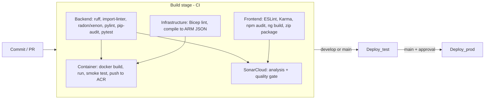

# CI, CD and release management (Part 3)

One YAML pipeline, `azure-pipelines.yml`, takes the code from a commit to a running app in Azure.



| Brief (Part 3) | Where it is |
|---|---|
| **Task 1** CI build on Azure DevOps | `Build` stage, runs on every push and PR to `main`/`develop` |
| Use build agents | Microsoft-hosted `ubuntu-latest` for every job; the backend job can run on our **self-hosted agent** (run the pipeline → *Agent pool for the backend job* → `PestPatrol-SelfHosted`) |
| Custom tasks used in all builds | `pipelines/templates/steps/*.yml`: `setup-python`, `setup-node`, `publish-results`, `smoke-test`, `sonarcloud`. Any pipeline in the project can call them with `template:` |
| Automated build integrated with SonarCloud | `SonarCloud` job → `steps/sonarcloud.yml`, settings in `/sonar-project.properties` |
| Plugins to analyse code, feedback to the team | SonarCloud (bugs, vulnerabilities, code smells, duplication, coverage), plus ruff, ESLint, codespell, import-linter, radon/xenon, pylint, pip-audit, npm audit. Feedback: see *Feedback to the team* below |
| Manage quality and avoid technical debt | Quality gate fails the build (`sonar.qualitygate.wait=true`); see *Managing technical debt* below |
| **Task 2** Delivery pipeline, code → deployment | `Deploy_test` and `Deploy_prod` stages |
| Release management / orchestration | Azure DevOps **Environments** `pest-test` and `pest-prod`: deployment history per build, approval before production |
| Release definition with deployment tasks | `pipelines/templates/stages/deploy.yml`, the same steps for every environment |
| Web Deploy package to an Azure Web App | Frontend zip package (`pestpatrol-web.zip`) deployed with the *Azure Web App* task. Zip deploy is the Linux equivalent of an MSDeploy package, which only works on Windows/IIS |
| *Higher grade:* tests / quality gates in the deployment | Unit tests + SonarCloud gate before any deploy; container smoke test in CI; post-deployment smoke tests; manual approval on prod |
| *Higher grade:* ARM templates | `infra/main.bicep` and `infra/shared.bicep`, compiled to ARM JSON in CI and deployed with the *ARM template deployment* task |
| *Higher grade:* containers | Backend is a Docker image in Azure Container Registry, run by App Service for Containers |

> **Design change from Part 1:** Task 1 planned AKS for the backend. AKS is the most expensive part of the design (Task 7.4 cost risk), so for the demo the same container runs on **App Service for Containers**. The image is unchanged, so moving to AKS later only changes the deployment step.

---

## One-time set-up

Do these **before** pushing the new pipeline, otherwise the run fails at the start because a service connection or variable group doesn't exist.

### 1. Azure service connection

*Project settings → Service connections → New → Azure Resource Manager → Workload identity federation (automatic)*

* Scope: **Subscription** (the pipeline creates the resource groups), leave *Resource group* empty
* Name: **`sc-pestpatrol-azure`**
* Tick *Grant access permission to all pipelines*

If this fails with a permission error, your university account can't create app registrations. Use a team member's personal Azure subscription instead, or ask the lecturer.

### 2. SonarCloud

1. Sign in at <https://sonarcloud.io> with Azure DevOps (or GitHub). Create an **organization** and import the project.
2. *Project → Administration → Analysis Method*: turn **Automatic Analysis off** (we analyse in the pipeline).
3. Copy the **project key** into `sonar-project.properties` (`sonar.projectKey=`).
4. *My Account → Security*: generate a token.
5. Azure DevOps: install the **SonarQube Cloud** extension from the Marketplace (*Organization settings → Extensions*).
6. *Project settings → Service connections → New → SonarQube Cloud*: paste the token, name it **`sc-sonarcloud`**.
7. *Project → Administration → New Code*: set **Previous version** or **Number of days = 14**, so the gate judges each sprint's new code.

### 3. Variable group

*Pipelines → Library → + Variable group*, name **`pestpatrol`**:

| Variable | Example | Secret |
|---|---|---|
| `azureSubscriptionId` | `00000000-…` (*Subscriptions* in the Azure portal) | |
| `location` | `northeurope` (must be allowed by your subscription's region policy) | |
| `acrName` | `pestpatrolfc2026` (lowercase letters and numbers, unique in Azure) | |
| `sonarOrganization` | your SonarCloud organization key | |
| `djangoSecretKey` | 50 random letters and numbers | 🔒 |
| `demoAdminPassword` | password for the `admin` account on `/admin/` | 🔒 |
| `azureMapsKey` | Azure Maps key, or `none` | 🔒 |

*Pipeline permissions → +* → add the pipeline.

### 4. Environments (release management)

*Pipelines → Environments → New environment*: **`pest-test`** and **`pest-prod`** (Resource: None).
On `pest-prod`: *⋮ → Approvals and checks → Approvals* → add the team, minimum 1 approver. Optionally add *Business hours*.

### 5. Self-hosted agent (build agents)

1. *Organization settings → Agent pools → Add pool → Self-hosted*, name **`PestPatrol-SelfHosted`**, grant access to all pipelines.
2. *New agent* → follow the download and `config.sh` steps on a laptop with **Python 3.12** and Git. You need a PAT with *Agent Pools (read, manage)*.
3. `./run.sh`, and the agent shows as *Online*.
4. Run the pipeline and choose `PestPatrol-SelfHosted` for the backend job.

### 6. Branch policies

Keep the CI pipeline as the required *Build validation* on `main` and `develop` (see [BRANCHING.md](BRANCHING.md)). PR builds run the whole Build stage including the SonarCloud gate, but never deploy.

---

## What each deployment does

1. **ARM template**: creates or updates `rg-pestpatrol-<env>`: App Service plan (Linux B1), backend Web App (container), frontend Web App (Node 22 + pm2), Log Analytics and Application Insights. It also points the backend at the image `pest-backend:<build number>`.
2. **Frontend package**: writes `env.js` with this environment's API address into the zip, then deploys it. The same build is deployed to test and prod, only `env.js` changes.
3. **Smoke tests** (deployment quality gate):
   * backend `/healthz` reports **this build number**, so the old container can't pass the test
   * `/api/species/` returns seeded data (the database works)
   * frontend serves `index.html` and `env.js` points at the right API

If any step fails, the stage fails and prod is not deployed.

**Rollback:** *Pipelines → Environments → pest-prod* → pick an earlier run → *Rerun stage*. Every image stays in ACR, tagged with its build number.

---

## Feedback to the team

* **Pull requests**: SonarCloud decorates the PR with new issues and the gate result. The PR can't be merged while the build (including the gate) fails.
* **Build summary**: the *Publish quality gate result* task shows the gate and links to SonarCloud.
* **Dashboard** (*Overview → Dashboards → Quality*): Test Results Trend, Code Coverage, Build History. Environments (*Pipelines → Environments*) show which build is in test and prod.
* **Notifications**: SonarCloud *My Account → Notifications* (new issues, gate changes); Azure DevOps *Project settings → Notifications → Build fails*.
* **README badges**: SonarCloud *Information → Badges* (quality gate, coverage, technical debt).

## Managing technical debt

| Practice | How |
|---|---|
| Stop new debt | The **Sonar way** gate on new code: no new bugs or vulnerabilities, ≥ 80 % coverage on new code, ≤ 3 % duplication, all security hotspots reviewed. Failing it fails the build. |
| Keep the existing gates | ruff, ESLint, xenon (complexity rank B or better), import-linter (layers), coverage minimums (backend 80 %, frontend 60 %) |
| Pay old debt down | Each sprint: a Task tagged `tech-debt` for the top SonarCloud issues by severity. The SonarCloud *Technical Debt* measure (minutes to fix) is tracked from sprint to sprint. |
| Don't hide it | Issues are only marked *Won't fix* / *False positive* in SonarCloud with a comment, and that is raised in the PR review. |

## Container database (demo limitation)

The backend container uses **SQLite inside the container**. `entrypoint.sh` migrates and seeds it on every start, so it works out of the box, but **sightings are lost when the container restarts** (every deployment). Azure SQL (Task 5) needs only `DB_ENGINE=mssql` and the `DB_*` settings, plus the Azure SQL resource in `main.bicep`.

## Cost and clean-up

Two B1 plans + Basic ACR ≈ €30 per month. After the demo:

```bash
az group delete -n rg-pestpatrol-test --yes --no-wait
az group delete -n rg-pestpatrol-prod --yes --no-wait
az group delete -n rg-pestpatrol-shared --yes --no-wait
```

## Troubleshooting

| Problem | Fix |
|---|---|
| *Service connection … could not be found* at queue time | Create it with the exact name, or run with *Run SonarCloud analysis* / *Push the image and deploy* unticked |
| SonarCloud shows 0 % coverage | Check the *Point coverage paths at this checkout* step output: the paths must start with this agent's sources folder |
| SonarCloud: *You are running CI analysis while Automatic Analysis is enabled* | Turn Automatic Analysis off (set-up step 2) |
| Backend smoke test times out | Web App → *Log stream*. Usually a missing app setting or the image can't be pulled |
| *Resource provider not registered* | Subscription → *Resource providers*: register `Microsoft.Web`, `Microsoft.ContainerRegistry`, `Microsoft.Insights`, `Microsoft.OperationalInsights` |
| *RequestDisallowedByPolicy* | Your subscription only allows some regions: change `location` |